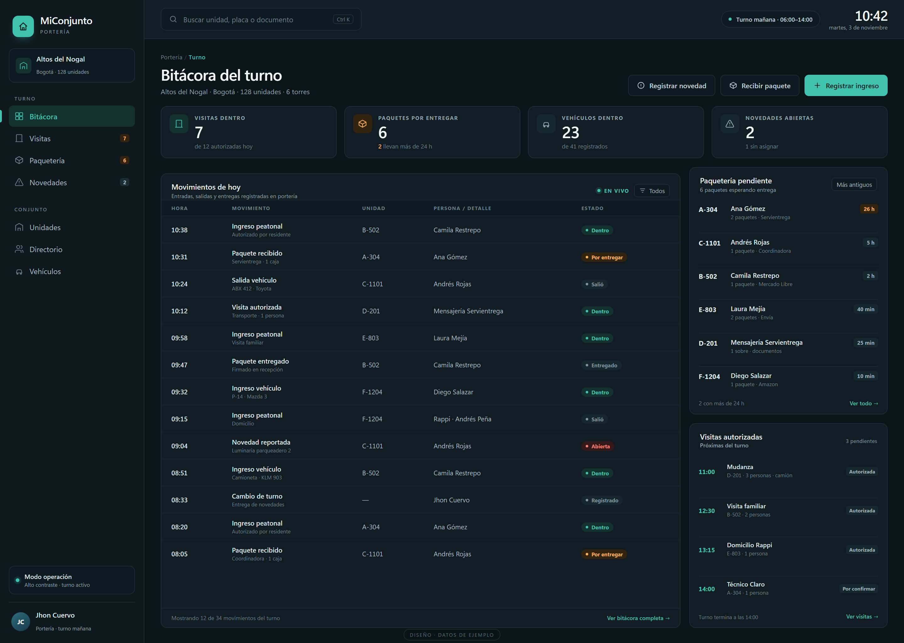
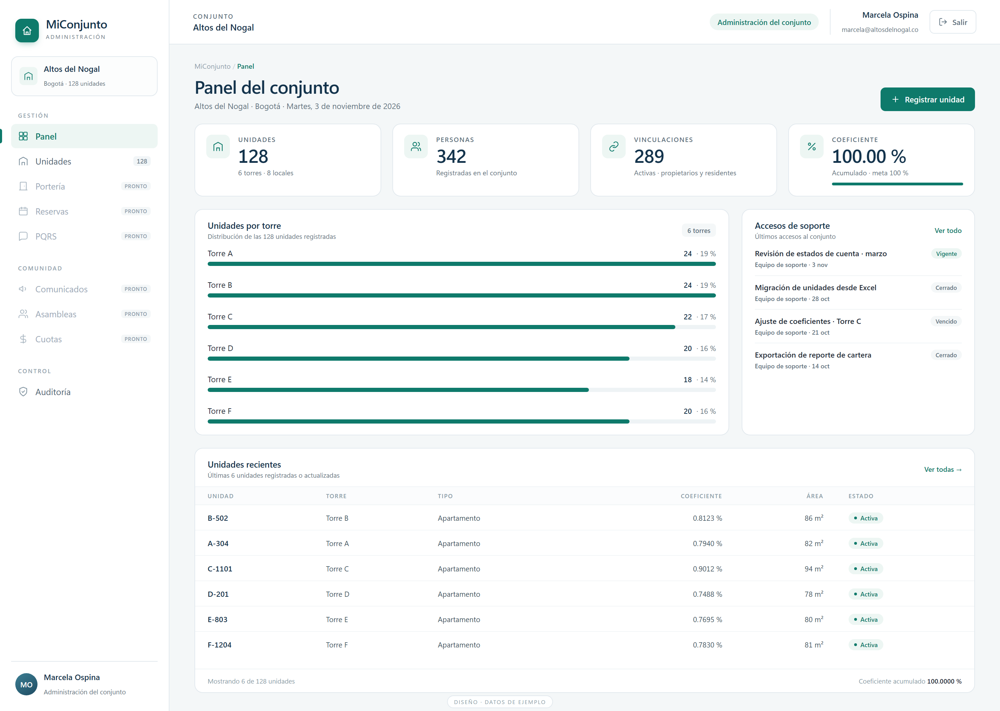
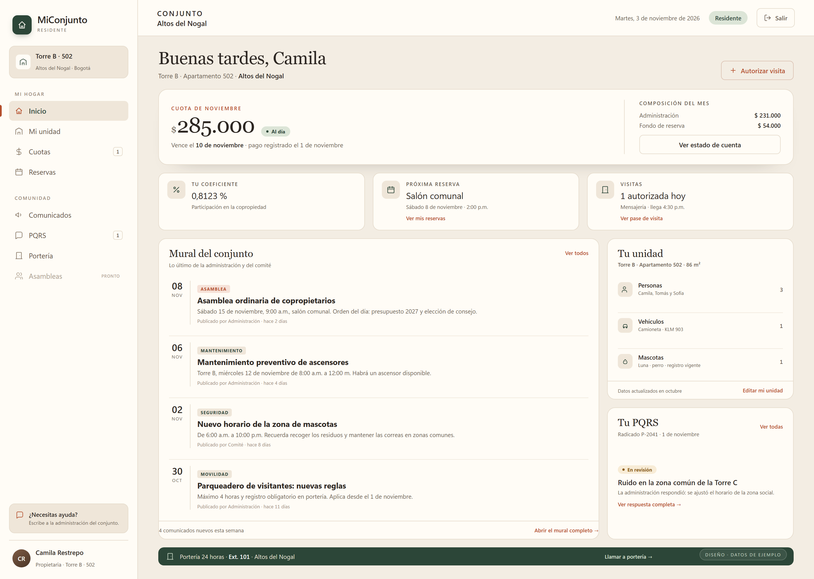

# Tres diseños, tres roles — MiConjunto

**Fecha:** 3 de noviembre de 2026
**Base:** sistema **Mirador** ya adoptado, con el tono cálido de **Patio** para el residente.
**Alcance:** una pantalla principal por rol —portería, administración y residentes— con los mismos datos de ejemplo para poder compararlas.

> Los mockups usan el mismo conjunto ficticio de todo el proyecto: **Altos del Nogal** (Bogotá), 128 unidades, 6 torres, 342 personas, 289 vinculaciones. Así las tres pantallas hablan del mismo lugar y no de tres productos distintos.

---

## La idea

No son tres marcas ni tres productos: es **una sola marca con tres ritmos de lectura**.

| Rol | Pantalla | Tono | La pregunta que responde |
|---|---|---|---|
| **Portería** | Bitácora del turno | Operación, alto contraste | ¿Qué está pasando ahora mismo en la puerta? |
| **Administración** | Panel del conjunto | Institucional, sereno | ¿Cómo está el conjunto y qué requiere mi atención? |
| **Residentes** | Inicio del residente | Cálido, cercano | ¿Qué pasa con mi casa y con mi conjunto? |

El sistema visual es el mismo —marino, verde azulado, tarjetas de 12 px, chips de estado—, pero cambia la **densidad**, el **contraste** y el **vocabulario**. Portería necesita ver mucho en poco espacio y a cualquier hora; administración necesita comparar y reportar; el residente necesita entender sin aprender.

---

## 1 · Portería — Bitácora del turno

**Archivo:** [`porteria.html`](roles/porteria.html)

**Qué resuelve.** La garita vive de una sola pregunta: qué entró, qué salió y qué quedó pendiente. Por eso la pantalla no es un tablero de indicadores: es una **bitácora en vivo** con cuatro cifras de contexto arriba y dos columnas de pendientes a la derecha.

**Decisiones**

- **Modo operación oscuro.** Es la única pantalla oscura del producto. Funciona en turnos de noche y en garitas con poca luz, y separa visualmente «estar operando» de «estar administrando». El color sigue siendo Mirador: marino profundo, verde azulado y ámbar solo para lo que espera.
- **Reloj y turno siempre visibles.** Hora grande, fecha y franja `06:00–14:00`. En una portería el turno es el marco de todo lo demás.
- **Una acción principal.** «Registrar ingreso» en verde; «Recibir paquete» y «Registrar novedad» en segundo plano. Nada compite con el registro de entrada.
- **Estados por color y por texto.** `Dentro`, `Salió`, `Por entregar`, `Abierta`: el color acompaña, no reemplaza la palabra.
- **Tiempo de espera como dato duro.** La paquetería muestra horas acumuladas y destaca en ámbar lo que pasa de 24 h; es el reclamo más frecuente en portería.
- **Búsqueda por unidad, placa o documento**, con atajo `Ctrl K`, porque el 90 % de las consultas llegan con uno de esos tres datos.

**Qué se puede construir hoy.** Unidades, personas, vinculaciones y vehículos ya existen en Supabase. **Visitas, paquetería y novedades no**: requieren tablas nuevas (ver *Brecha de datos*).

---

## 2 · Administración — Panel del conjunto

**Archivo:** [`administracion.html`](roles/administracion.html)

**Qué resuelve.** Es la pantalla que ya está implementada: cuatro indicadores, distribución por torre, accesos de soporte y últimas unidades. La versión de este mockup usa datos de ejemplo para mostrar el panel «lleno», porque hoy el conjunto real está vacío.

**Decisiones**

- **Jerarquía por cifra.** Unidades, personas, vinculaciones y coeficiente acumulado. El coeficiente es el dato que sostiene cuotas, asambleas y coeficientes de copropiedad; por eso tiene barra de progreso hacia 100 %.
- **Lo pendiente se marca, no se simula.** Portería, reservas, PQRS, comunicados, asambleas y cuotas aparecen con la etiqueta `pronto`. Un administrador no debería descubrir que un módulo está vacío después de hacer clic.
- **Auditoría visible en la navegación**, no escondida en un menú de configuración: los accesos de soporte son parte del gobierno del conjunto.
- **Densidad media-alta**: tablas de 40 px, chips de 9 px y coeficientes tabulados. Es la pantalla que se proyecta en una asamblea.

**Qué se puede construir hoy.** Todo lo que muestra la imagen, salvo los módulos marcados como `pronto`.

---

## 3 · Residentes — Inicio del residente

**Archivo:** [`residente.html`](roles/residente.html)

**Qué resuelve.** El residente no entra a «gestionar»: entra a saber si debe pagar, si tiene una reserva, si hay un comunicado que le concierne y si su visita ya llegó. La pantalla se ordena alrededor de esas cuatro respuestas.

**Decisiones**

- **Tono cálido de Patio.** Fondo hueso, tarjetas crema, titulares en Georgia y acentos terracota. El cálido se queda aquí y en el ingreso: nunca invade la operación.
- **La cuota primero.** Monto grande, estado `Al día` y fecha de vencimiento. Es lo que más se consulta y lo que más ansiedad genera.
- **Mural, no bandeja de entrada.** Los comunicados se leen como un mural de vecindario: fecha, etiqueta, titular y un resumen de dos líneas.
- **«Tu unidad» como espejo.** Personas, vehículos y mascotas: lo que el residente declaró y lo que la administración usa para citar, autorizar y facturar.
- **Visitas con pase.** Autorizar una visita se resuelve en un botón, no en un formulario largo.
- **Portería siempre a un toque**, en una franja al pie con la extensión.

**Qué se puede construir hoy.** Unidad, coeficiente, personas, vehículos y mascotas de la unidad del residente. **Cuotas, reservas, comunicados y PQRS no existen todavía.**

---

## Navegación por rol

| Módulo | Administración | Portería | Residente |
|---|---|---|---|
| Panel / Inicio | ● | — | ● |
| Bitácora del turno | — | ● | — |
| Visitas | — | ● | ● (autorizar) |
| Paquetería | — | ● | — |
| Novedades | — | ● | — |
| Unidades | ● | ● (consulta) | — |
| Mi unidad | — | — | ● |
| Directorio | — | ● | — |
| Vehículos | — | ● | — |
| Cuotas | ○ | — | ● |
| Reservas | ○ | — | ● |
| Comunicados | ○ | — | ● |
| PQRS | ○ | — | ● |
| Asambleas | ○ | — | ○ |
| Auditoría | ● | — | — |

● disponible · ○ pendiente (`pronto`) · — no aplica

La regla es simple: **cada rol ve solo lo que puede resolver**. Portería no necesita cuotas; el residente no necesita la bitácora completa; administración no necesita registrar paquetes.

---

## Lo que comparten las tres

- **Tokens únicos** de [`app/globals.css`](../../app/globals.css): marino `#12324B`, verde `#0E7A6B`, menta `#EDF6F3`; cálidos `#F3EDE3`, `#FFFCF6`, `#B44E2B` solo para residente e ingreso.
- **La misma gramática de navegación**: barra lateral, módulo activo con barra vertical, grupos por área, etiqueta `pronto` para lo que no existe.
- **Cifras tabuladas** y formatos colombianos (`$ 285.000`, `0,8123 %`, `86 m²`).
- **Estados con texto además de color**: `Al día`, `Por entregar`, `Abierta`, `En revisión`.
- **Un solo conjunto de ejemplo** en las tres pantallas.

**Lo que cambia:** contraste (claro / oscuro / cálido), densidad (alta / media-alta / media) y tipografía de titulares (sans / sans / serif).

---

## Brecha de datos

Las tres pantallas se diseñaron sobre lo que el producto debe ser, no solo sobre lo que hoy existe. Para llevarlas a la app faltan tablas:

| Módulo | Tablas necesarias | Rol que las usa |
|---|---|---|
| Portería | `visitas`, `paquetes`, `novedades`, `movimientos` | Portería, residente (autorizar) |
| Cuotas | `cuotas`, `pagos`, `estados_cuenta` | Administración, residente |
| Reservas | `zonas_comunes`, `reservas` | Administración, residente |
| Comunicados | `comunicados`, `lecturas` | Administración, residente |
| PQRS | `pqrs`, `respuestas_pqrs` | Administración, residente |
| Notificaciones | `notificaciones` | Todos |

Todas con `conjunto_id`, RLS por rol y trazabilidad de quién creó y quién cambió cada registro.

---

## Orden recomendado para implementar

1. **Shell por rol** (esta semana): la navegación cambia según `perfiles.rol`. Es barato y evita que un residente vea módulos de administración. **Implementado** — ver [`Shell_Por_Rol_v1.md`](Shell_Por_Rol_v1.md).
2. **Portería**: `visitas`, `paquetes` y `novedades`. Es el módulo con más dolor operativo y el que justifica la pantalla oscura.
3. **Residente**: cuota del mes y comunicados, en ese orden. Con esos dos, el inicio cálido ya se sostiene.
4. **Cuotas y reservas** para administración, que a su vez devuelven al panel su gráfico principal.

---

## Archivos

| Archivo | Contenido |
|---|---|
| [`roles/porteria.html`](roles/porteria.html) | Mockup editable · Portería, modo operación |
| [`roles/administracion.html`](roles/administracion.html) | Mockup editable · Administración, Mirador |
| [`roles/residente.html`](roles/residente.html) | Mockup editable · Residente, Patio cálido |
| [`roles/img/porteria.png`](roles/img/porteria.png) | Captura 1440 × 1024 a 2× |
| [`roles/img/administracion.png`](roles/img/administracion.png) | Captura 1440 × 1024 a 2× |
| [`roles/img/residente.png`](roles/img/residente.png) | Captura 1440 × 1024 a 2× |

Los HTML son la fuente de verdad: se abren en el navegador y se ajustan sin regenerar las imágenes.
