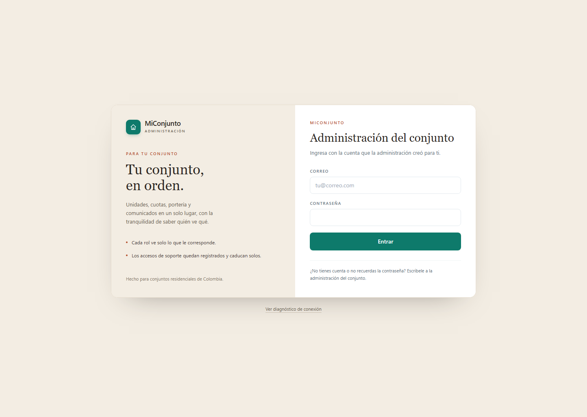
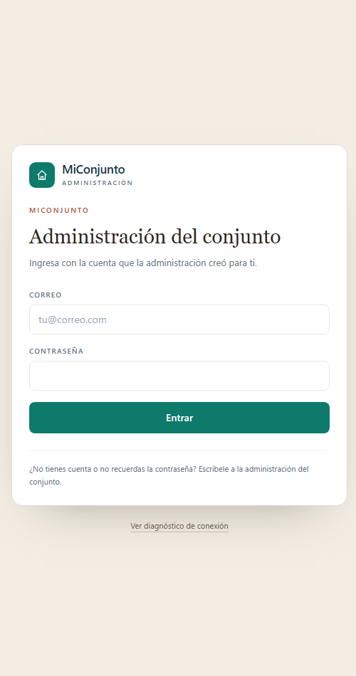
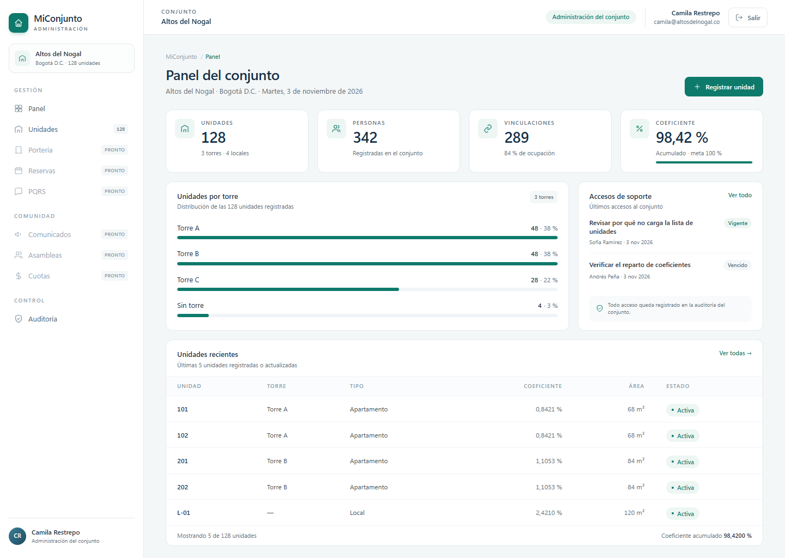
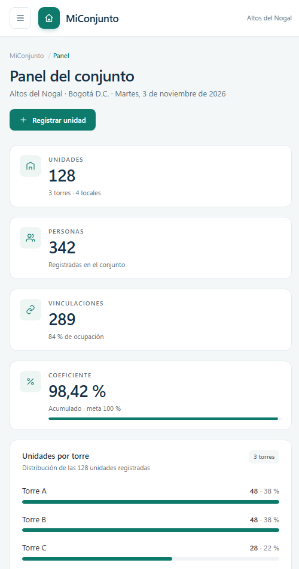

# Implementación del sistema Mirador · v1

**Fecha:** 3 de noviembre de 2026
**Base:** propuesta C · Mirador, con los complementos acordados de A · Patio.
**Alcance:** tokens, navegación, panel, unidades, ingreso, auditoría y Admin.

---

## Decisión

- **C · Mirador** queda como sistema visual del producto: panel, unidades, cuotas, auditoría y asambleas.
- De **A · Patio** se toma únicamente el tono cálido para el **ingreso** y para los textos dirigidos al residente: fondo hueso, titulares en serif y acentos terracota.
- **B · Conserje** no se implementa todavía. Queda reservada como *modo operación* de portería si el uso real lo justifica.

---

## Tokens

Definidos en [`app/globals.css`](../../app/globals.css) con `@theme` de Tailwind 4. Las pantallas usan los nombres (`bg-surface`, `text-navy`, `border-line`), no valores hexadecimales sueltos.

| Token | Valor | Uso |
|---|---|---|
| `canvas` | `#F4F7F8` | Fondo de la aplicación |
| `surface` | `#FFFFFF` | Tarjetas, tablas y barra lateral |
| `navy` | `#12324B` | Títulos, cifras y texto fuerte |
| `teal` | `#0E7A6B` | Acción principal, estado activo y acentos |
| `teal-dark` | `#0B6357` | Hover de la acción principal |
| `mint` | `#EDF6F3` | Fondo de iconos y chips positivos |
| `ink` | `#1D2B36` | Texto de cuerpo |
| `muted` | `#5F7280` | Texto secundario y metadatos |
| `line` | `#E2E9EE` | Bordes de tarjetas y tablas |
| `line-soft` | `#F0F4F6` | Separadores internos |
| `warm` | `#F3EDE3` | Fondo del ingreso (tono de A) |
| `warm-surface` | `#FFFCF6` | Tarjeta del ingreso |
| `warm-ink` | `#2B2521` | Titulares serif del ingreso |
| `terracotta` | `#B44E2B` | Acentos cálidos del ingreso |

**Tipografía:** Segoe UI Variable con pesos 400/600; Georgia solo en los titulares del ingreso. Las cifras usan `tabular-nums` para que las columnas no bailen.

**Formas:** tarjetas de 12 px, controles de 8 px, chips de 99 px; bordes de 1 px y sombras solo en el ingreso.

---

## Piezas construidas

| Pieza | Archivo | Notas |
|---|---|---|
| Tokens y base | [`app/globals.css`](../../app/globals.css) | Colores, tipografía, foco visible y `summary` sin marcador |
| Iconografía | [`components/icons.tsx`](../../components/icons.tsx) | SVG de trazo 1,7 px, sin dependencias |
| Navegación | [`components/panel/shell.tsx`](../../components/panel/shell.tsx) | Barra lateral fija, topbar, menú móvil y estado activo |
| Layout del panel | [`app/panel/layout.tsx`](../../app/panel/layout.tsx) | Sesión, rol y conjunto; delega la pintura al shell |
| Panel | [`app/panel/page.tsx`](../../app/panel/page.tsx) | KPIs, unidades por torre, accesos de soporte y tabla |
| Unidades | [`app/panel/unidades/page.tsx`](../../app/panel/unidades/page.tsx) | Tabla densa, chips y formularios plegables |
| Ingreso | [`app/ingresar/page.tsx`](../../app/ingresar/page.tsx) | Composición cálida de A con la acción en verde |
| Auditoría | [`app/panel/auditoria/page.tsx`](../../app/panel/auditoria/page.tsx) | Registro de accesos con estado |
| Admin | [`app/admin/layout.tsx`](../../app/admin/layout.tsx) | Cabecera marino y contenido sobre `canvas` |
| Diagnóstico | [`app/estado/page.tsx`](../../app/estado/page.tsx) | Misma base visual, sin adornos |

La navegación conserva los siete módulos de la propuesta, pero solo **Panel**, **Unidades** y **Auditoría** son enlaces. Los demás se muestran como «pronto» en lugar de simular pantallas que no existen.

---

## Impacto en las pantallas

### Ingreso

Tomado de A: fondo hueso, tarjeta crema, titular serif y acentos terracota. La acción principal sigue en verde para no separar el ingreso del resto del producto. En móvil se oculta el panel editorial y queda el formulario.

### Panel

La estructura del mockup se mantiene: cuatro indicadores, dos tarjetas de análisis, tabla de unidades recientes y navegación lateral con el módulo activo en menta.

Se sustituyeron dos bloques que el mockup resolvía con datos inexistentes:

| Mockup | Implementación | Motivo |
|---|---|---|
| KPI «Cuotas al día» | KPI «Coeficiente acumulado», con barra hacia 100 % | El módulo de cuotas todavía no existe; el coeficiente sí es un dato real y crítico |
| Gráfico «Estado de cuotas» | «Unidades por torre», con barras y porcentaje | Mide la distribución real del conjunto y usa el mismo lenguaje visual |
| Agenda del día | Accesos de soporte recientes | La agenda depende de reservas y asambleas, aún no construidas |

> Las capturas del panel usan datos de ejemplo para verificar la composición. En la aplicación, los mismos componentes se alimentan de Supabase y respetan RLS.

### Unidades y auditoría

- Tablas con encabezado en mayúsculas de 10 px, filas de 40 px, coeficientes tabulados y chips de estado.
- Formularios plegables con el mismo alto de control que el ingreso.
- Coeficiente acumulado visible en la cabecera y en el pie de la tabla.
- En móvil, la tabla se desplaza dentro de la tarjeta; la página no se desborda.

---

## Diferencias deliberadas con el mockup

1. **No hay buscador global ni campana.** No existen todavía la búsqueda ni las notificaciones; un campo que no busca habría sido una promesa falsa. La topbar muestra conjunto, rol, cuenta y salida.
2. **Los módulos pendientes están marcados.** «Pronto» evita que un residente o la administración crea que la función ya opera.
3. **El panel vacío enseña el camino.** Si el conjunto no tiene unidades ni personas, se muestran los tres pasos de carga en lugar de tarjetas en cero.
4. **El tono cálido no invade el panel.** La calidez queda en el ingreso y en el lenguaje; la operación usa la lectura institucional de C.

---

## Verificación

- `npm run build` compila sin errores de TypeScript ni de Tailwind.
- Capturas de escritorio (1440 × 1024) y móvil (500 px de ancho).
- El menú móvil cierra con `Escape`, con el botón de cierre y al navegar.
- Los estados vacíos existen para panel, unidades y auditoría.

---

## Siguiente fase

1. Módulo de cuotas: al existir, la tarjeta de análisis vuelve a ser el gráfico de cuotas del mockup.
2. Búsqueda global y notificaciones, con datos reales.
3. Pantallas del residente con el lenguaje cálido de A (comunicados, reservas, ingreso de visitas).
4. Modo operación de portería con la densidad de B, solo si la operación lo pide.

Los tres diseños por rol —portería, administración y residentes— están definidos en [Diseno_Por_Rol_v1.md](Diseno_Por_Rol_v1.md), con sus mockups y capturas.
